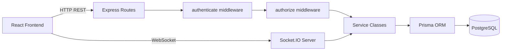
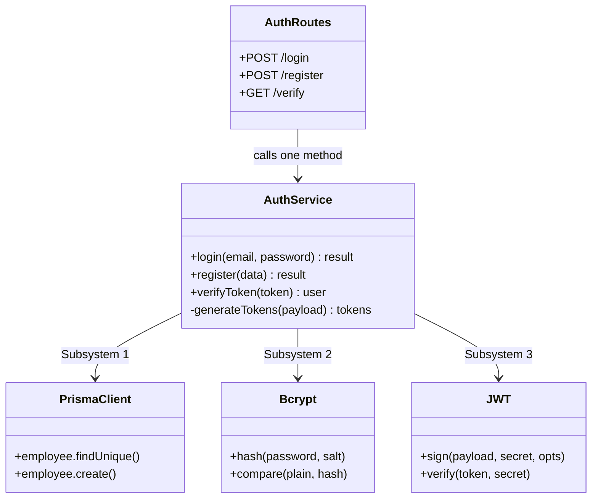
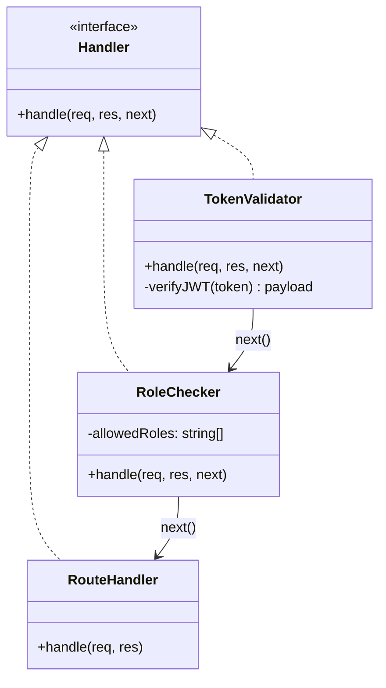
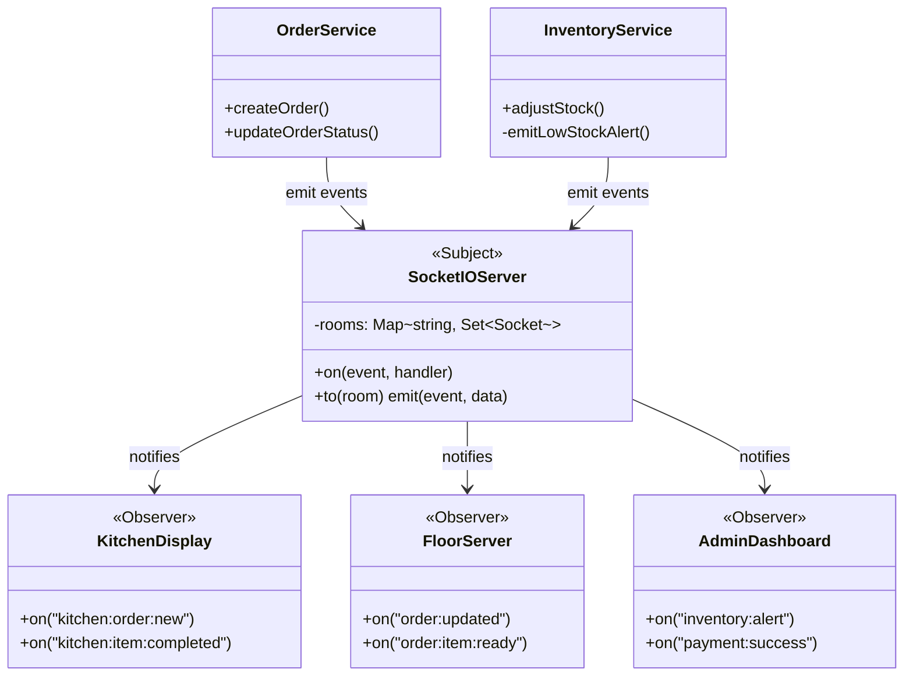

# Part 1 — Pattern Discovery

## 1. Application Description

The system is a full-stack **Restaurant Point-of-Sale (POS)** application. Staff use it to manage table layouts, place orders, process payments, track inventory, and coordinate kitchen workflows in real time.

| Layer | Technology |
|---|---|
| Frontend | React 18 + Redux Toolkit + Socket.IO client (Vite, port 5173) |
| API Gateway | Express.js router (port 3000) |
| Middleware | JWT authentication + role-based authorization |
| Service Layer | TypeScript service classes |
| ORM | Prisma (abstracts PostgreSQL) |
| Real-time | Socket.IO (bidirectional events) |

## 2. Framework Architecture



---

## 3. Pattern Inventory — Confirmed Only

| # | Pattern | Category | Status |
|---|---|---|---|
| 1 | Façade | Structural | ✅ Confirmed |
| 2 | Chain of Responsibility | Behavioral | ✅ Confirmed |
| 3 | Observer | Behavioral | ✅ Confirmed |

---

## 4. Pattern-to-Source Mapping

---

### Pattern 1 — Façade

#### Participants & Relationships



#### Source-Code Evidence

| File | Lines | Evidence |
|---|---|---|
| [src/routes/auth.routes.ts](file:///e:/Sem%207/DP_Project/restaurant-pos-system/apps/backend/src/routes/auth.routes.ts) | 18–25 | Route calls single facade method `authService.login()` |
| [src/services/auth.service.ts](file:///e:/Sem%207/DP_Project/restaurant-pos-system/apps/backend/src/services/auth.service.ts) | 64–97 | [login()](file:///e:/Sem%207/DP_Project/restaurant-pos-system/apps/backend/src/services/auth.service.ts#60-92) internally orchestrates [prisma](file:///e:/Sem%207/DP_Project/restaurant-pos-system/apps/backend/prisma/schema.prisma), `bcrypt`, `jwt` |
| [src/services/auth.service.ts](file:///e:/Sem%207/DP_Project/restaurant-pos-system/apps/backend/src/services/auth.service.ts) | 104–115 | [generateTokens()](file:///e:/Sem%207/DP_Project/restaurant-pos-system/apps/backend/src/services/auth.service.ts#116-123) private — hidden from router |
| [src/services/analytics.service.ts](file:///e:/Sem%207/DP_Project/restaurant-pos-system/apps/backend/src/services/analytics.service.ts) | 6–51 | [getSalesAnalytics()](file:///e:/Sem%207/DP_Project/restaurant-pos-system/apps/backend/src/services/analytics.service.ts#6-53) hides 3 nested Prisma queries |
| [src/services/order.service.ts](file:///e:/Sem%207/DP_Project/restaurant-pos-system/apps/backend/src/services/order.service.ts) | 7–62 | [createOrder()](file:///e:/Sem%207/DP_Project/restaurant-pos-system/apps/backend/src/services/order.service.ts#7-81) fetches menu items, calculates prices, writes order |

```ts
// auth.routes.ts — line 20 (Facade call — route knows nothing about bcrypt or jwt)
const result = await authService.login(email, password);

// auth.service.ts — line 64 (Facade body — hides 3 subsystems)
async login(email: string, password: string) {
  const user = await prisma.employee.findUnique(...)  // Subsystem 1
  await bcrypt.compare(password, user.passwordHash)   // Subsystem 2
  const { accessToken } = this.generateTokens(...)    // Subsystem 3
  return { user, accessToken };
}
```

**Purpose:** Clients (routes) interact with a single unified interface. Subsystem changes (swapping bcrypt, changing JWT options) require no changes to route files.

---

### Pattern 2 — Chain of Responsibility

#### Participants & Relationships



#### Source-Code Evidence

| File | Lines | Evidence |
|---|---|---|
| [src/middleware/auth.ts](file:///e:/Sem%207/DP_Project/restaurant-pos-system/apps/backend/src/middleware/auth.ts) | 12–26 | [authenticate](file:///e:/Sem%207/DP_Project/restaurant-pos-system/apps/backend/src/middleware/auth.ts#12-27) — Handler 1, calls `next()` on success |
| [src/middleware/auth.ts](file:///e:/Sem%207/DP_Project/restaurant-pos-system/apps/backend/src/middleware/auth.ts) | 28–40 | [authorize(roles)](file:///e:/Sem%207/DP_Project/restaurant-pos-system/apps/backend/src/middleware/auth.ts#28-41) — Handler 2, calls `next()` on success |
| [src/index.ts](file:///e:/Sem%207/DP_Project/restaurant-pos-system/apps/backend/src/index.ts) | 48–53 | Chain assembled: `authenticate → authorize → routeHandler` |

```ts
// middleware/auth.ts — Handler 1 (lines 12-26)
export const authenticate = (req, res, next) => {
  const token = req.headers.authorization?.replace('Bearer ', '');
  if (!token) return res.status(401).json({ error: 'Authentication required' }); // ← BREAK chain
  req.user = jwt.verify(token, JWT_SECRET);
  next(); // ← PASS to next handler
};

// middleware/auth.ts — Handler 2 (lines 28-40)
export const authorize = (roles) => (req, res, next) => {
  if (!roles.includes(req.user.role))
    return res.status(403).json({ error: 'Insufficient permissions' }); // ← BREAK chain
  next(); // ← PASS to route handler
};

// index.ts — line 48 (Chain assembly)
app.use('/api/tables', authenticate, authorize(['SERVER','MANAGER','ADMIN']), tableRoutes);
//                     ^Handler 1^   ^=======Handler 2=======^               ^Handler 3^
```

**Purpose:** Authentication and authorization are completely decoupled. New middleware handlers (e.g., rate-limiting, request logging) can be inserted into the chain without modifying existing handlers.

---

### Pattern 3 — Observer

#### Participants & Relationships



#### Source-Code Evidence

| File | Lines | Evidence |
|---|---|---|
| [src/websocket.ts](file:///e:/Sem%207/DP_Project/restaurant-pos-system/apps/backend/src/websocket.ts) | 28–110 | Subject registers all event handlers, routes to room subscribers |
| [src/websocket.ts](file:///e:/Sem%207/DP_Project/restaurant-pos-system/apps/backend/src/websocket.ts) | 49–53 | `order:created` event notifies floor AND kitchen rooms simultaneously |
| [src/websocket.ts](file:///e:/Sem%207/DP_Project/restaurant-pos-system/apps/backend/src/websocket.ts) | 66–68 | Kitchen observers subscribe via `socket.join(kitchen room)` |
| [src/services/inventory.service.ts](file:///e:/Sem%207/DP_Project/restaurant-pos-system/apps/backend/src/services/inventory.service.ts) | 117–125 | [emitLowStockAlert()](file:///e:/Sem%207/DP_Project/restaurant-pos-system/apps/backend/src/services/inventory.service.ts#102-111) — publisher broadcasts inventory state |
| [src/services/order.service.ts](file:///e:/Sem%207/DP_Project/restaurant-pos-system/apps/backend/src/services/order.service.ts) | 59 | `io?.to(...).emit('order:new', order)` — publisher notifies on order create |

```ts
// websocket.ts — lines 49-53 (Subject dispatches to multiple observer rooms)
socket.on('order:created', (data) => {
  io.to(`restaurant:${restaurantId}`).emit('order:new', data);          // → Observer: floor
  io.to(`restaurant:${restaurantId}:kitchen`).emit('kitchen:order:new', data); // → Observer: kitchen
});

// inventory.service.ts — lines 117-125 (Publisher)
private emitLowStockAlert(item: any) {
  io?.to(`restaurant:${item.restaurantId}`).emit('inventory:alert', { ... });
}

// websocket.ts — lines 66-68 (Observer subscribes)
socket.on('kitchen:join', () => {
  socket.join(`restaurant:${restaurantId}:kitchen`); // ← Observer registers itself
});
```

**Purpose:** Kitchen screens, floor tablets, and admin dashboards update in real time without polling. Adding a new observer type (e.g., a manager phone app) requires zero changes to the backend services — it simply joins the appropriate room.

---

## 5. Verification Summary

| Pattern | Verified | Rejected | Reason |
|---|---|---|---|
| Façade | ✅ | — | Single method entry point hiding 3+ subsystems proven in code |
| Chain of Responsibility | ✅ | — | Two middleware handlers with `next()` chaining, assembled in [index.ts](file:///e:/Sem%207/DP_Project/restaurant-pos-system/apps/backend/src/index.ts) |
| Observer | ✅ | — | Socket.IO room model maps exactly to GoF Subject-Observer relationship |
| Singleton | — | ❌ | `const prisma = new PrismaClient()` is module scoping, not a `getInstance()` governed class |
| Strategy | — | ❌ | `PaymentMethod` is a DB enum string, not interchangeable algorithm classes |
| Factory Method | — | ❌ | Records created directly via `prisma.x.create()`, no abstract creator class |
| Adapter | — | ❌ | No incompatible interface wrapper found anywhere in codebase |
| Iterator | — | ❌ | `.map()` / `.reduce()` are JS built-ins, not custom GoF Iterator implementations |

## Current audit correction (2026-10-11)

This earlier narrative contains unverified and superseded classifications/path references. Use the canonical `../../data/patterns.csv`, `../../data/pattern_counts.csv`, and `../../AUDIT_REPORT.md`. Active Record is rejected (Prisma schema alone is insufficient); Express middleware as GoF Chain of Responsibility is uncertain. Historical verification assertions below are not accepted as independent test evidence.
