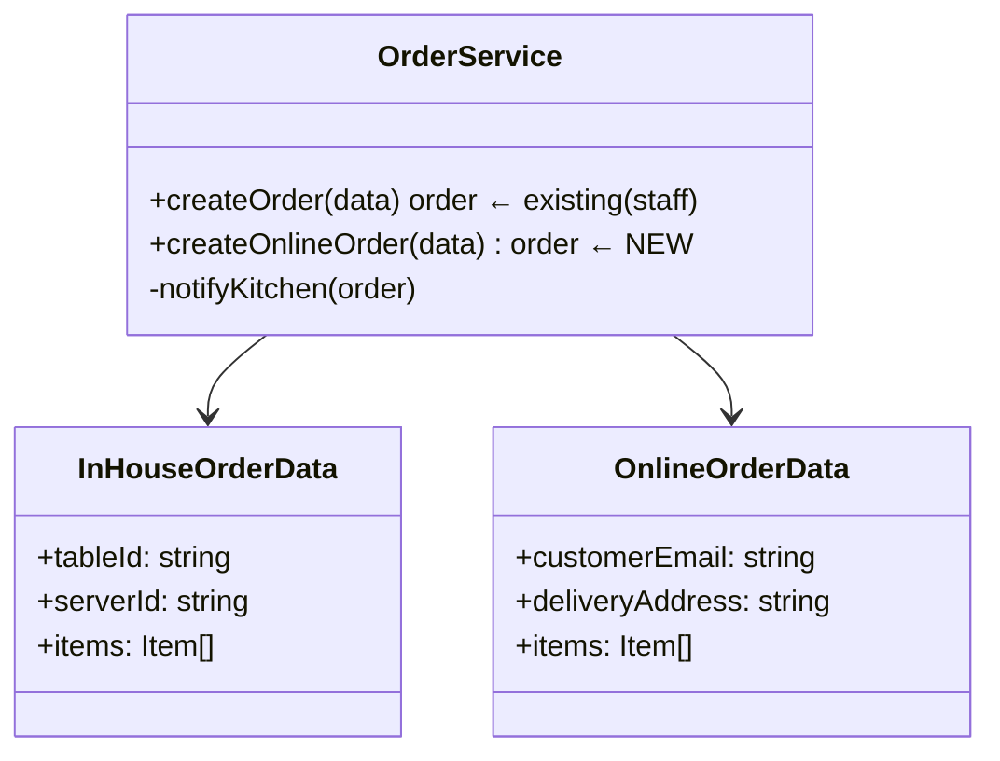
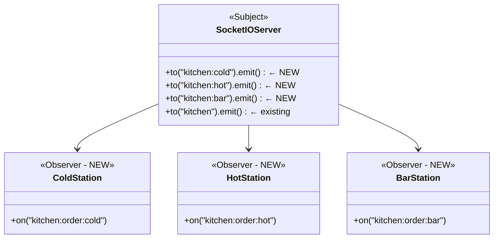
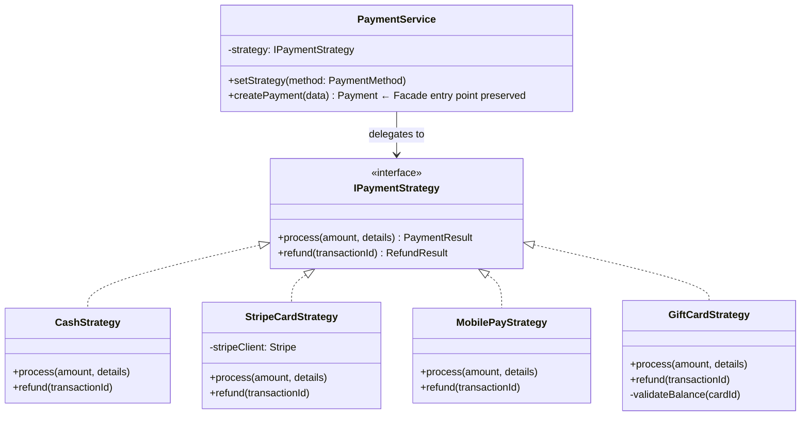

# Part 2 — Software Evolution Analysis

> [!IMPORTANT]
> This codebase already has KDS room routing ([websocket.ts](file:///e:/Sem%207/DP_Project/restaurant-pos-system/apps/backend/src/websocket.ts) lines 66–73) and multiple `PaymentMethod` enum values. All evolutions below are formulated as **extensions** of the existing system.

---

## Evolution 1 — Online Ordering

### Baseline State (Current Code)

Orders can only be created by authenticated in-house staff:

```
Waiter (authenticated) → POST /api/orders → authenticate middleware → OrderService → DB
```

External customers have no access path.

### Evolved State

Customers place orders directly from a public web page or mobile app:

```
Customer (public) → POST /api/orders/online →  [no auth required]  → OrderService → DB
                                                                          ↓
                                               Kitchen notified via Observer (Socket.IO)
```

### Pattern Impact

#### Façade — MODIFIED

The `OrderService.createOrder()` facade must be extended to handle the public case. The server-assignment logic (`serverId: 'default'`) needs a real pathway for online orders.



#### Chain of Responsibility — MODIFIED

The existing chain (`authenticate → authorize → route`) must be **bypassed** for the public endpoint. A new branch is added:

```
Before:  ALL routes → authenticate → authorize → handler

After:   /api/orders (staff)  → authenticate → authorize → createOrder()
         /api/orders/online   → [validate input only]  → createOnlineOrder()
```

A new `validateOnlineOrder` handler replaces auth for the public path — a new link in a new chain.

#### Pattern Impact Summary

| Pattern | Impact | Nature |
|---|---|---|
| Façade | [OrderService](file:///e:/Sem%207/DP_Project/restaurant-pos-system/apps/backend/src/services/order.service.ts#6-329) gains new public method | Extension |
| Chain of Responsibility | New chain added for public endpoint | Extension |
| Observer | No change — kitchen is already notified via existing `order:new` event | Unaffected |

---

## Evolution 2 — Kitchen Workflow Refinement

### Baseline State (Current Code)

The system already has a kitchen room in [websocket.ts](file:///e:/Sem%207/DP_Project/restaurant-pos-system/apps/backend/src/websocket.ts):
- `kitchen:join` → joins `restaurant:{id}:kitchen` broadcast room (line 66)
- `kitchen:item:complete` → emits `kitchen:item:completed` (line 71)
- [OrderItemStatus](file:///e:/Sem%207/DP_Project/restaurant-pos-system/apps/backend/src/services/order.service.ts#190-217): `PENDING → SENT_TO_KITCHEN → PREPARING → READY → SERVED`

All kitchen items are broadcast to **one** kitchen room — no station routing.

### Evolved State

Items are routed to **specific stations** based on `CourseType` (enum already in schema):
- `APPETIZER / SALAD / SOUP` → Cold Station
- `ENTREE / SIDE` → Hot Station  
- `DESSERT / BEVERAGE` → Bar/Dessert Station

```
Before: Order Item → KITCHEN (single broadcast)

After:  APPETIZER  → kitchen:cold   room
        ENTREE     → kitchen:hot    room
        DESSERT    → kitchen:bar    room
```

### Pattern Impact

#### Observer — EXTENDED

New Observer rooms are added. The Publisher (backend) now routes events to the correct station room. New subscriber types join their specific room.



**Websocket change required — [websocket.ts](file:///e:/Sem%207/DP_Project/restaurant-pos-system/apps/backend/src/websocket.ts):**
```ts
// NEW handlers alongside existing kitchen:join
socket.on('kitchen:station:join', ({ station }) => {
  socket.join(`restaurant:${restaurantId}:kitchen:${station}`); // cold/hot/bar
});

socket.on('order:created', (data) => {
  data.items.forEach(item => {
    const station = getStation(item.courseType); // e.g., 'cold', 'hot', 'bar'
    io.to(`restaurant:${restaurantId}:kitchen:${station}`).emit('kitchen:order:new', item);
  });
});
```

#### Chain of Responsibility — OPPORTUNITY

Kitchen item routing can itself be implemented as a CoR:
```
CourseTypeHandler → StationRouter → KitchenNotifier
```
Each handler checks if the course type matches its station, passes otherwise — a natural new CoR instance.

#### Pattern Impact Summary

| Pattern | Impact | Nature |
|---|---|---|
| Observer | New station rooms added; new subscriber types | Extension |
| Façade | [OrderService](file:///e:/Sem%207/DP_Project/restaurant-pos-system/apps/backend/src/services/order.service.ts#6-329) may delegate station-routing internally | Minor extension |
| Chain of Responsibility | New opportunity inside kitchen routing | New instance |

---

## Evolution 3 — Payment Method Extension

### Baseline State (Current Code)

`PaymentMethod` is a Prisma enum: `CASH | CREDIT_CARD | DEBIT_CARD | MOBILE_PAY | GIFT_CARD`

All payment types are stored identically in the DB. There is **no distinct processing logic** per method — just a label stored.

```ts
// payment.service.ts — line 13
const payment = await prisma.payment.create({ data: { method: data.method, ... } });
// → Same code path regardless of payment method
```

### Evolved State

Each payment method has distinct processing:
- `CREDIT_CARD / DEBIT_CARD` → call Stripe API
- `CASH` → open cash drawer, record change
- `MOBILE_PAY` → generate QR code / NFC handshake
- `GIFT_CARD` → validate gift card balance before processing

### New Pattern Introduced — Strategy



**New [PaymentService](file:///e:/Sem%207/DP_Project/restaurant-pos-system/apps/backend/src/services/payment.service.ts#5-142) structure:**
```ts
// payment.service.ts — EVOLVED
class PaymentService {
  private strategy: IPaymentStrategy;

  setStrategy(method: PaymentMethod) {
    const strategies = {
      'CASH':        new CashStrategy(),
      'CREDIT_CARD': new StripeCardStrategy(),
      'MOBILE_PAY':  new MobilePayStrategy(),
      'GIFT_CARD':   new GiftCardStrategy(),
    };
    this.strategy = strategies[method];
  }

  async createPayment(data) {
    this.setStrategy(data.method);         // select algorithm
    const result = await this.strategy.process(data.amount, data); // execute
    return prisma.payment.create({ data: { ...data, transactionId: result.id } });
  }
}
```

#### Pattern Impact Summary

| Pattern | Impact | Nature |
|---|---|---|
| Strategy | **New pattern introduced** — `IPaymentStrategy` with 4 concrete classes | Brand new |
| Façade | `PaymentService.createPayment()` preserved as public interface; internals restructured | Internal evolution |
| Observer | `payment:success` / `payment:processing` events unchanged | Unaffected |
| Chain of Responsibility | [authenticate](file:///e:/Sem%207/DP_Project/restaurant-pos-system/apps/backend/src/middleware/auth.ts#12-27) chain unchanged | Unaffected |

---

## Overall Evolution Pattern Impact Matrix

| Pattern | Evolution 1 (Online Order) | Evolution 2 (KDS Stations) | Evolution 3 (Payments) |
|---|---|---|---|
| Façade | Modified | Minor extension | Internal restructure |
| Chain of Responsibility | New chain added | New opportunity | Unaffected |
| Observer | Unaffected | Extended with new rooms | Unaffected |
| Strategy | Not present | Opportunity | **Newly introduced** |

## Current audit correction (2026-10-11)

This earlier narrative's per-criterion "Implemented" labels and test claims have not been validated end-to-end. Consult `../../AUDIT_REPORT.md` and the canonical `../../data/patterns_evolution.csv`. The online ordering interface can create a local-only preview after API failure; card/mobile payment behavior is simulated; live database and socket integration tests were not run. Standalone pattern prototypes do not establish application integration.
